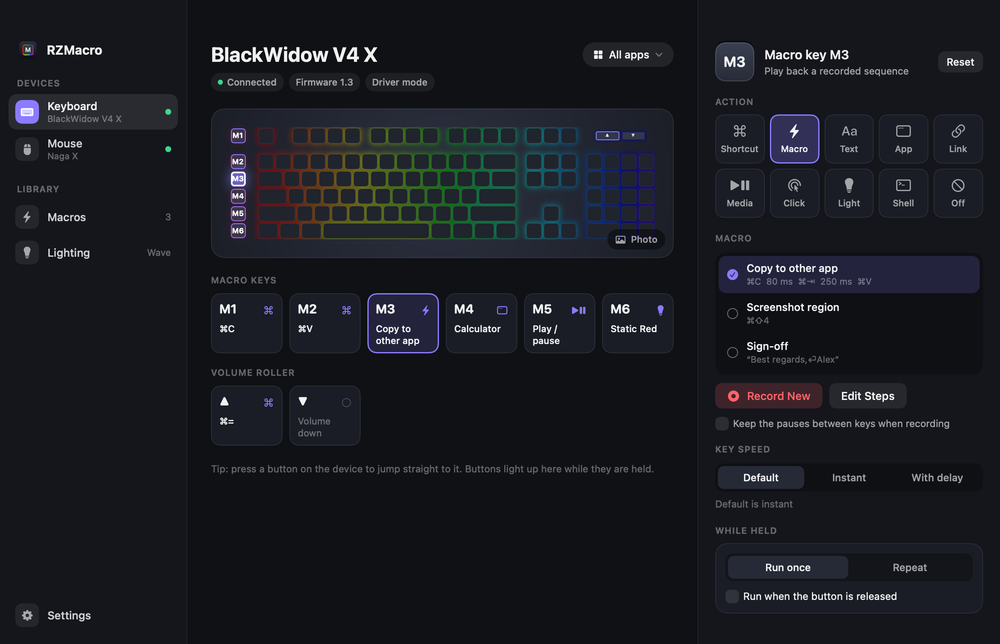
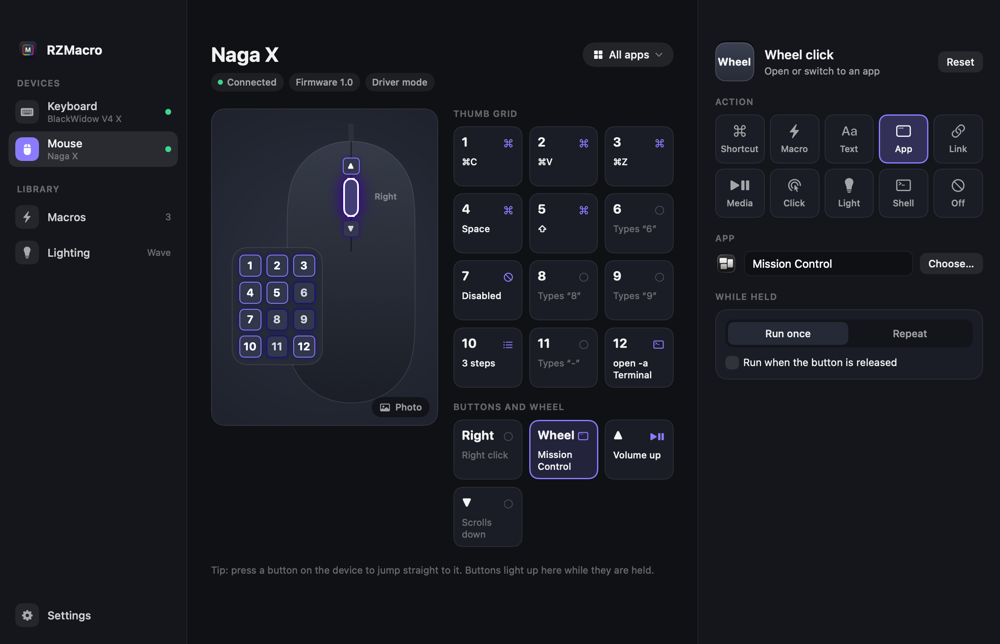
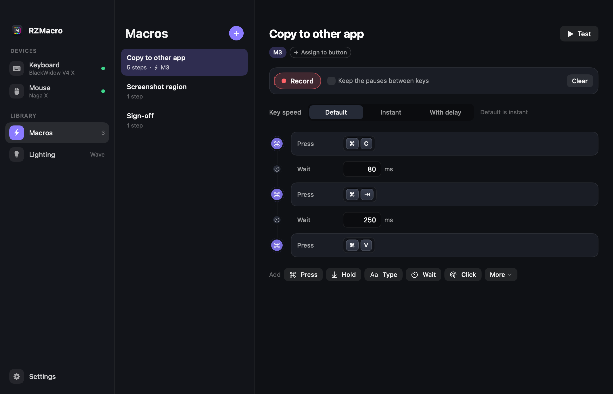
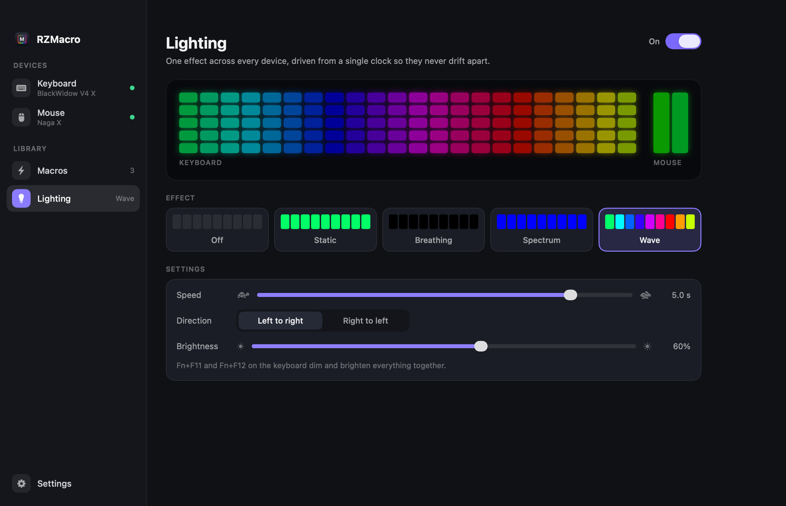
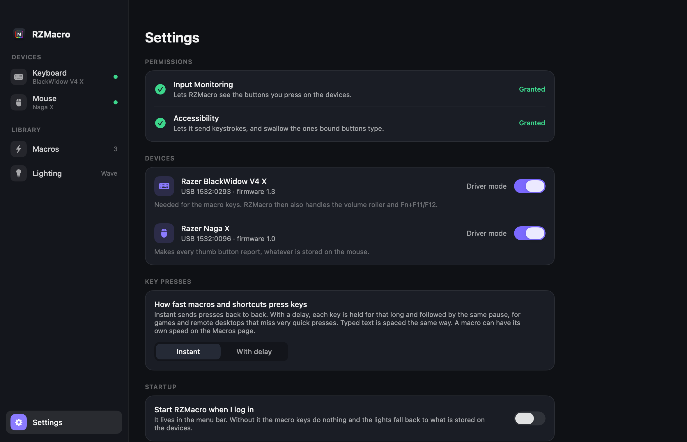
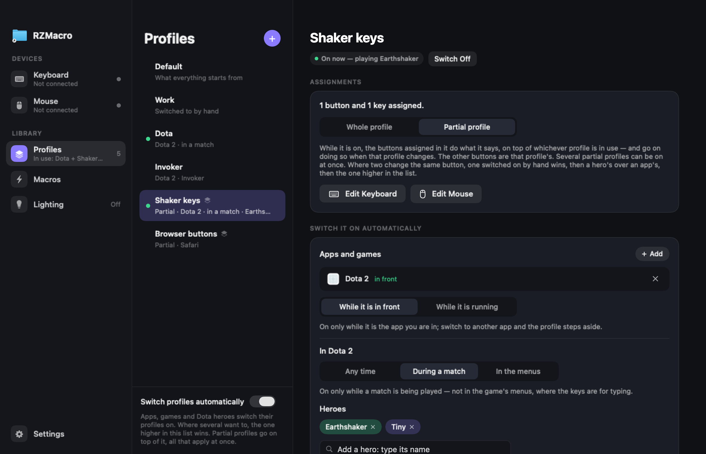

# RZMacro

Macro keys, button and key remapping, profiles that follow your game, and synced RGB lighting
for Razer keyboards and mice on macOS.

Razer's own Mac software doesn't support many of its devices, older ones in particular. On a
Mac that leaves a keyboard's macro keys doing nothing, a mouse's extra buttons stuck with
whatever was last stored on them, and the lighting running each device's own effect. RZMacro
is a small free app that fills that gap: it talks to the devices directly and gives you a
window to configure them in.



> **Tested on two devices only:** the **BlackWidow V4 X** keyboard and the **Naga X** mouse —
> the ones I own. Other Razer keyboards and mice get generic support that nobody has tried
> yet. If you have one, please try it and open an issue with what you find; pull requests
> adding devices are very welcome. See [Other devices](#other-devices).

## What it does

- **Assign anything to a button.** Macro keys, the mouse's thumb grid, its right button, wheel
  click and wheel directions, the keyboard's volume roller: a
  keyboard shortcut, a macro, typed text, an app, a link or file, a media key, a mouse click,
  a lighting change, a shell command — or nothing. Run once, hold while held, or repeat.
- **Macros.** Record them by typing, or build them step by step: key presses, held keys,
  text, pauses, clicks. Choose per macro whether keys go out instantly or with a delay (some
  games need one).
- **Remap ordinary keys too.** Caps Lock into Escape, Alt and Win swapped, a key that runs a
  macro. A plain key-for-key swap is done by the keyboard driver itself, so it works
  everywhere, games and password fields included.
- **Other makes of keyboard, for their keys.** Switch one on in Settings and its keys can be
  remapped and given macros like a Razer keyboard's, with the same profiles. (Lighting and
  macro keys are for Razer devices only.)
- **Profiles.** Named sets of assignments, one built on another. Switch between them from the
  menu bar or with a button — or let them switch themselves: while an app is in front or a
  game is running, and in **Dota 2** only during a match, only in the menus, or only while
  you are playing certain heroes.
- **Partial profiles.** A few buttons changed under the same conditions, on top of whichever
  profile is in use — and still on top when that profile changes.
- **Lighting in sync.** Off, static, breathing, spectrum or wave, rendered from one clock and
  streamed to every device, so keyboard and mouse never drift apart.
- **Lives in the menu bar**, and everything is also in a plain config file and a small
  command-line tool.

| | |
|---|---|
|  |  |
|  |  |

## Install

Requires macOS 14 or later.

### Download

1. Get `RZMacro-<version>.zip` from the [latest release](../../releases/latest) (Apple silicon),
   unzip it and move `RZMacro.app` to your Applications folder.
2. Open it. The app is not notarized by Apple (that needs a paid developer account), so macOS
   will refuse the first time: go to **System Settings → Privacy & Security**, scroll down, and
   click **Open Anyway**.
3. Give it the two permissions it asks for — see [Permissions](#permissions).

Each release is a new app as far as macOS is concerned, so the permissions have to be granted
again after updating. Building from source with your own signing identity avoids that.

### Build from source

With Xcode (or its command line tools) installed:

```sh
git clone https://github.com/vshaveyko/rzmacro.git
cd rzmacro
./scripts/install.sh
```

That builds the app, puts it in `~/Applications`, links the `rzmacro` command into
`~/.local/bin` if that folder exists, and opens it. If you have an Apple Development
certificate it is used for signing, which lets macOS remember the permissions across rebuilds.

To have it running all the time, turn on **Settings → Start RZMacro when I log in**.
`./scripts/uninstall.sh` removes the app again; your configuration is kept.

## Permissions

macOS asks you to allow two things, in **System Settings → Privacy & Security**:

- **Input Monitoring** — to read button presses from the devices. macOS doesn't always prompt
  for this one; if RZMacro isn't in the list, add it with the `+` button.
- **Accessibility** — to send the keystrokes your macros contain, and to swallow the keystroke
  a mouse button would otherwise type when you have given that button something else to do.

What it does with them: it opens only USB devices with Razer's vendor id, and other keyboards
that you have switched on yourself in Settings (the rest it knows by name only). It looks at
keyboard events only to decide whether one came from a bound mouse button (or is an Fn
combination the keyboard has handed over). Of a keyboard's own keys it acts on the ones you
have given something to do and ignores the rest. Nothing you type is stored or sent anywhere.

The app makes no network connections, with two exceptions that happen only if you ask: the
**Photo** button on a device page downloads that model's product picture from razer.com, and
setting up [Dota 2 hero detection](#dota-2) makes it listen on this Mac's own loopback
address (`127.0.0.1`) for the game to report to. To know which profile applies it also looks
at which app is in front and which are running — their identifiers, nothing else.

## Using it

- **Keyboard / Mouse.** Click a button in the picture or in the list — or just press it on the
  device — and choose an action from the tiles on the right. *Shortcut* starts listening
  straight away. *Macro* lets you pick a saved macro or record a new one on the spot. The menu
  in the top corner chooses which profile you are editing.
- **Ordinary keys.** Every key in the keyboard drawing can be clicked and given an action
  (*Pick a Key* selects one by pressing it). Give it a single key and leave *Hold down* on,
  and it simply is that key — Caps Lock is Escape. Give it anything else and it works like a
  macro key. Only the Razer keyboard is affected, not the Mac's own — unless you switch
  another keyboard on (below).
- **Shortcuts for a game.** A key or button that should be a combination in a game — W as
  Alt+W — wants *Hold down*: the keys go down when you press and come up when you let go, as
  if you held them yourself. *Run once* presses and releases them within a few milliseconds,
  and a game that looks at its keys once a frame can miss the modifier and see a plain W.
  (*Settings → Key presses* slows *Run once* down, for when it has to be a tap.) What a game
  calls Alt is the Mac's Option key, ⌥ — see [Good to know](#good-to-know) if the recorder
  shows ⌘ instead.
- **Other keyboards.** *Settings → Other keyboards* lists every keyboard that is plugged in
  and not Razer's, the Mac's own included, each with a switch. One that is switched on gets
  the Keyboard page too: the same assignments apply to it, and its drawing can be set to its
  size (full, tenkeyless, 75%, 65%, 60%) from the corner of the picture. With more than one
  keyboard in use, the chip beside the name chooses which is shown.
- **Profiles.** Make profiles, say what each is based on, and say when it switches on by
  itself: add apps or games (while in front, or for as long as they run). With Dota 2 among
  them, the profile can be narrowed to a match, to the menus, and to heroes — type a few
  letters of a hero's name and press Return.
  Higher in the list wins when several apply. To switch by hand use the menu-bar icon, or give
  a button the *Profile* action — next, previous, or a particular one. A profile chosen by
  hand while a game's profile is on lasts until you leave the game.
- **Partial profiles.** A profile set to *Partial profile* does not take over: while it is on
  — for its apps, games and heroes, or switched on by hand — the buttons assigned in it do
  what it says, and every other button goes on doing what the profile in use says, whichever
  that is and however often it changes. Several can be on at once; a button two of them change
  goes to one switched on by hand, then to the more specific rule (hero, app in front, app
  running), then to the one higher in the list. The menu-bar icon, or a button given the
  *Profile* action, switches one on and off; switched off by hand while its app or hero has it
  on, it stays off until that app or hero has gone and come back.
- **Macros.** *Record* captures the keys you type (optionally with the pauses between them).
  Steps can be changed, reordered, duplicated and added by hand. A **Hold** step keeps a key
  down until you let go of the button, so "Press F4, Hold F4" is a double-tap-and-hold.
  *Assign to button* binds the macro without leaving the page; *Test* runs it after three
  seconds.
- **Lighting.** Pick an effect, colours, speed and brightness. Fn+F11 / Fn+F12 on the keyboard
  dim and brighten everything together.
- **Settings.** Permissions, connected devices, driver mode, key speed, start at login.

## Dota 2

A profile for Dota 2 can be narrowed to the heroes you choose — one layout for Invoker,
another for Meepo, on top of a general one for the game — and to a match or to the menus:
remapped keys during a match, plain ones in the menus, where they are for typing.



RZMacro learns the hero from Dota itself, through Valve's Game State Integration: the
interface stream overlays use, in which the game posts its state to addresses listed in
settings files in its own folder. Nothing is read from the game's memory. To set it up:

1. On the **Profiles** page add Dota 2 to a profile's apps and click **Set Up**. That writes one
   small file, `gamestate_integration_rzmacro.cfg`, into Dota's `cfg/gamestate_integration`
   folder, asking for the hero and the player's own state and pointing at this Mac only.
   **Remove** deletes it again.
2. In Steam, right-click Dota 2 → Properties → General → Launch Options and add
   `-gamestateintegration`. The game ignores those files without it. The Profiles page says
   whether it is set.
3. Restart Dota 2.

A profile with heroes is in use only while one of them is being played; one without is in use
whichever hero you play. Base a hero's profile on your Dota profile and it only has to contain
what is different for that hero. Or make it a partial profile, and those few buttons change
for the hero on top of whichever profile you have in use.

*During a match* is what the game itself reports as playing; *In the menus* is everything
else while the game is running. The game is not heard from at all before the first match, and
a match that stops reporting for 25 seconds counts as over. Nothing tells RZMacro that the
chat line is open during a match: the game does not say.

## Other devices

**Keyboards that aren't Razer's** can be used for their keys: remapping, macros on keys,
profiles. They are opened only if you switch them on (*Settings → Other keyboards*, or
`keyboards` in the config file). Nothing else about them is touched — no lighting, no modes.

Of Razer's own, only the two models above have been tested. Everything specific to a model lives in one table,
[`Sources/rzmacro/DeviceProfiles.swift`](Sources/rzmacro/DeviceProfiles.swift): its special
buttons and how its LEDs are addressed. Any other device with Razer's USB vendor id (`1532`)
gets a generic profile:

- **Buttons.** The page lists special buttons as you press them. This covers what Razer
  devices have in common: keys the device reports as vendor codes once it is in driver mode
  (macro keys, extra mouse buttons), and mouse buttons that type keyboard keys.
- **Lighting.** One colour per device, set with the plain "static" command on the usual zones:
  static, breathing and spectrum still stay in sync; wave becomes a colour cycle.

**If you try it on another device, please report back** — working or not. Useful to include:

```sh
rzmacro status        # what was detected, and which interfaces opened
rzmacro sniff         # then press the special buttons: shows what each one sends
```

To add a model properly, add a profile: USB product id, the buttons (`rzmacro sniff` shows
their codes), and the LED matrix size — OpenRazer's device list has `MATRIX_DIMS` for most
models. Keyboards with a macro column or a volume roller, and mice with a thumb grid, get a
drawing for free. Pull requests welcome.

## How it works

RZMacro is an ordinary app, not a kernel or DriverKit extension. It talks to the devices
through IOKit HID:

- **Driver mode.** Razer devices have a "driver mode" — what Synapse switches on under Windows.
  In it a keyboard reports its macro keys as vendor codes on a HID report macOS ignores; in
  normal mode those keys send nothing at all. A mouse reports all of its buttons with their
  factory keys regardless of what is stored in its on-board profile. RZMacro switches devices
  into driver mode while it runs and back when it quits.
- **Telling buttons from keys.** Presses are read straight from the device, so a thumb button
  that types `1` is told apart from the real `1` key. If the button is bound, an event tap
  swallows the keystroke and the assignment runs instead. Unbound buttons behave as usual.
- **Putting back what driver mode takes away.** In driver mode the BlackWidow's volume roller
  turns into a scroll wheel and its Fn layer stops working. RZMacro claims the roller's
  interface and sends volume keys, and handles Fn+F11/F12 (brightness) itself.
- **Lighting.** Effects are computed in the app and streamed to the devices as frames. The
  devices' built-in effects each run on their own timer, which is why they drift.

The only thing it stores on a device is the LED brightness level (set to full, so the frames
it sends are visible). Button assignments and macros live on the Mac, not on the device.

## Config file and command line

Everything the window does is stored in `~/.config/rzmacro/config.json5`, which can also be
written by hand (JSON with comments; comments are lost when the app next saves):

```json5
{
  devices: { keyboard: { driverMode: true }, mouse: { driverMode: true } },

  // Keyboards of other makes to look after as well, by USB id (`rzmacro status` lists the
  // ones plugged in). `layout` is how the app draws it: full, tkl, 75%, 65% or 60%.
  keyboards: [ { id: "05ac:024f", name: "Keychron K2", layout: "75%" } ],

  lighting: { effect: "wave", period: 6, brightness: 80 },

  // How keys are pressed, in ms held and ms paused per key; 0 (the default) is instant.
  keyDelay: 0,

  macros: {
    "Copy to other app": [ "cmd+c", { delay: 80 }, "cmd+tab", { delay: 250 }, "cmd+v" ],
    // A macro with its own key speed, whose second press is held until the button is let go:
    "Double-tap and hold": { steps: [ "f4", { down: "f4" } ], keyDelay: 30 },
  },

  bindings: {
    "keyboard.capslock": { keys: "escape", hold: true },   // Caps Lock is Escape
    "keyboard.M1": "cmd+space",
    "keyboard.M2": { text: "hello there" },
    "keyboard.M3": { macro: "Copy to other app" },
    "keyboard.M4": { keys: "space", repeat: 80 },      // turbo while held
    "keyboard.M6": { light: "static red" },
    "mouse.1": "cmd+c",
    "mouse.5": { keys: "shift", hold: true },          // the button is Shift while held
    "mouse.7": [],                                     // disabled
    "mouse.12": { app: "Terminal" },
    "keyboard.M5": { profile: "next" },                // step through the profiles
  },

  // Other sets of bindings. Each changes only what it mentions; the rest comes from what it
  // is based on ("Default" — the bindings above — unless it says otherwise; null for nothing).
  // Earlier profiles win when several want to switch on.
  profiles: [
    { name: "Browsing", apps: ["com.apple.Safari"],             // while Safari is in front
      bindings: { "mouse.1": "cmd+t", "mouse.2": "cmd+w" } },
    { name: "Dota", apps: ["com.valvesoftware.dota2"], dota: "playing",  // during a match only
      bindings: { "keyboard.left-cmd": [], "mouse.3": "f4" } }, // no Win key in the game
    { name: "Invoker", basedOn: "Dota", heroes: ["invoker"],    // while playing Invoker
      bindings: { "keyboard.capslock": { macro: "Copy to other app" } } },
    { name: "Recording", apps: ["com.obsproject.obs-studio"], whileRunning: true,
      bindings: { "keyboard.M1": "cmd+shift+r" } },             // even with OBS in the background
    // Partial: on top of whichever profile is in use, rather than in its place.
    { name: "Meepo keys", partial: true, heroes: ["meepo"],
      bindings: { "mouse.4": "tab" } },
    { name: "Numpad", partial: true,                            // on and off by hand:
      bindings: { "mouse.1": "kp1", "mouse.2": "kp2" } },       //   { profile: "Numpad" }
  ],
}
```

Buttons are named `keyboard.M1`…, `keyboard.roller-up` / `roller-down`, `mouse.1`…`mouse.12`,
`mouse.right-click`, `mouse.wheel-click`, `mouse.wheel-up` / `wheel-down`, `mouse.back` /
`forward`, or by what `rzmacro sniff` shows (`keyboard.raw:2a`, `mouse.key:3d`). The keyboard's ordinary
keys are `keyboard.<key>`: `keyboard.capslock`, `keyboard.a`, `keyboard.left-alt`, `keyboard.kp1`
(`rzmacro keys` lists them). Actions are a shortcut string
or one of `keys`, `text`, `shell`, `app`, `open`, `media`, `click`, `light`, `macro`, `profile`, `delay`,
`down`, `up`; a list is a sequence. Options: `hold`, `repeat`, `on: "release"`.

An ordinary key bound to one key with `hold: true` is swapped for it in the keyboard driver;
with anything else it runs the action and stops typing its own character. Heroes are written
the way the game or its players name them (`"invoker"`, `"Anti-Mage"`, `"npc_dota_hero_zuus"`).
`heroes` and `dota: "playing" | "menu"` narrow a profile's rule for Dota 2 (and put the game
among its `apps` if it is not there). A `partial: true` profile takes no `basedOn`, and
nothing can be based on one.
`autoSwitch: false` turns automatic switching off; `profileNotes: "always" | "except-apps" | "never"`
says when a profile change is shown on screen. Older files' `apps: { "<bundle id>": { … } }`
are still read, as one profile per app.

```
rzmacro show                        open the window
rzmacro status                      devices, permissions, bindings, lighting
rzmacro check                       validate the config file
rzmacro light wave period=4         try an effect
rzmacro press keyboard.M1 500       run a button's assignment as if held for 500 ms
rzmacro profile                     the profiles, and which one is in use and why
rzmacro profile next                switch by hand: a name, default, next, previous, auto
rzmacro profile Numpad              a partial profile's name switches it on, or off again
rzmacro dota                        hero detection: what it hears from the game
rzmacro sniff                       show button events as you press them
rzmacro keys                        key names usable in shortcuts
rzmacro quit                        stop (devices go back to normal mode)
```

The log is at `~/Library/Logs/rzmacro.log`.

## Good to know

- Animated lighting costs a few percent of one CPU core; static and off cost nothing.
- Password fields hide keystrokes from event taps, so a bound thumb button types its usual
  character there.
- Keys held by a macro don't auto-repeat: a game sees the key as down, a text field gets one
  character.
- The recorder captures key presses made in RZMacro's own window. Shortcuts macOS takes first
  (⌘Tab, Spotlight) have to be added as steps by hand.
- The left mouse button can't be reassigned, on purpose: losing it by accident would leave no
  way to click. A reassigned wheel direction applies to any wheel mouse that is plugged in
  (a turn of the wheel can't be traced to one device); trackpad scrolling is never affected.
- Bindings are per kind of device (`keyboard.…`, `mouse.…`), so two mice share theirs, and
  so do a Razer keyboard and any other keyboard you have switched on.
- Key swaps live in the keyboard driver while RZMacro runs and are taken off when it quits. If
  it is ever killed outright, they stay until it is started again or the keyboard is
  replugged. Caps Lock can be remapped like any key; the Fn key can't, it never leaves the
  keyboard.
- While a shortcut or macro is being recorded in the window, the keyboard's keys are
  themselves again, so what you press is what gets recorded.
- A recorded shortcut has the modifiers the keyboard sends, whatever is printed on the keys.
  On a keyboard in its Mac layout the key beside the space bar is Command (⌘) and the next
  one out is Option (⌥); in a PC layout it is the other way round. Games read Option as Alt,
  so if "Alt+W" was recorded as ⌘W, record it again with the other key, or write
  `"alt+w"` in the config file.
- Dota 2 says whether a match is being played and with which hero, and nothing more: not
  that the chat line is open. A profile can leave the keys alone in the menus; during a
  match, typing in chat goes through the remapped keys.
- A device's mode is not changed while one of its buttons is down. A Naga X whose side button
  is held across the change goes on reporting that button's key as held — to macOS as well —
  until the mouse loses power, and the button stops responding. RZMacro waits for the buttons
  to come up first (two seconds at most). Should a mouse end up that way regardless, the Mouse
  page and `rzmacro status` say so; unplugging the mouse itself, not a hub it shares, clears it.
- Razer Synapse can stay installed alongside.

## Credits and licence

MIT — see [LICENSE](LICENSE). Free to use, change and share.

What is known about Razer's USB protocol comes from the [OpenRazer](https://github.com/openrazer/openrazer)
project's years of reverse engineering, and from probing the two devices above. No OpenRazer
code is used here.

RZMacro is an independent project and is not affiliated with or endorsed by Razer Inc. "Razer",
"BlackWidow", "Naga" and "Synapse" are trademarks of their owner, used here only to say which
hardware this works with. It sends devices the same kind of commands Razer's own software
does, but you use it at your own risk.
